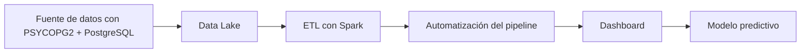
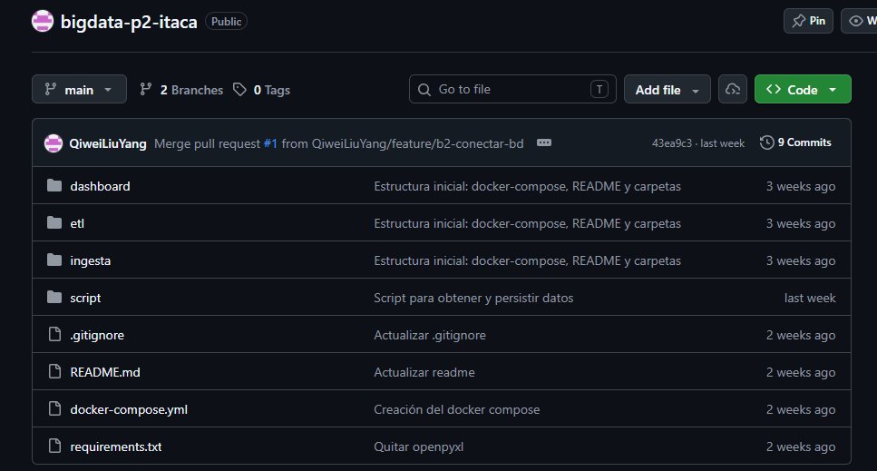
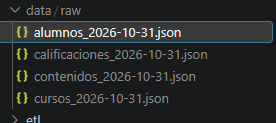
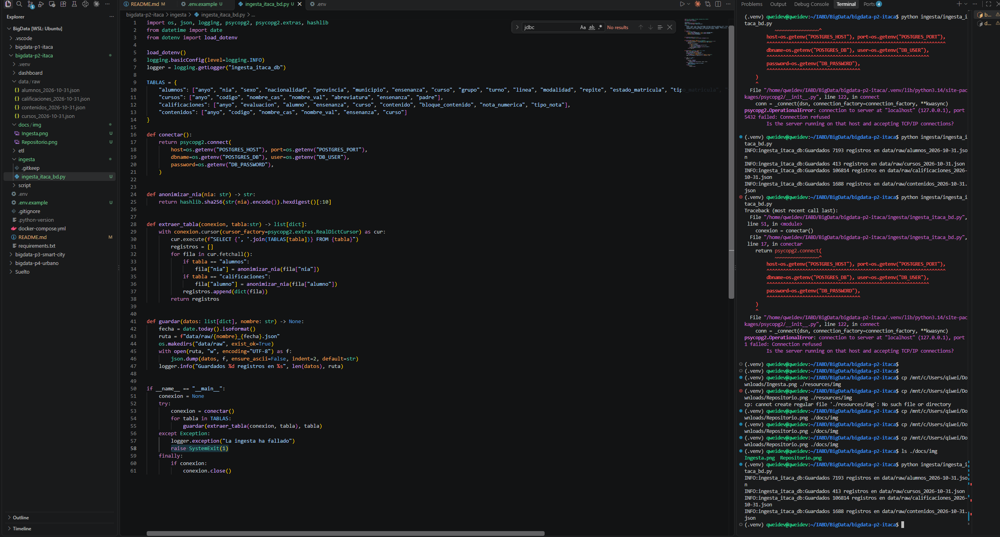

# Proyecto 2 - ITACA

## Descripción y objetivo

Lo mismo que el proyecto 1, el objetivo será construir un **dashboard** (cuadro de mandos) de análisis académico usando **Power BI**. Pero esta vez utilizaremos una fuente de datos **relacional** en lugar de **documental**. El objetivo será practicar un *pipeline* completo con otro paradigma de origen de datos habitual en proyectos.

## Arquitectura

Usaremos una arquitectura **Batch**.

Tecnologías usadas:
- PostgreSQL
- Spark
- Airflow
- Power BI



## Fuentes de datos

Las mismas cuatro tablas pero esta vez servidas por una base de datos **PostgreSQL** (réplica de ITACA) a la que se accede vía **PSYCOPG2** en lugar de ficheros **XML**:
- Alumnos
- Contenidos
- Calificaciones
- Cursos

| Tabla | Contenido | Campos Clave |
| --- | --- | --- |
| Alumnos | Un registro por alumno y año académico | Anyo, nia, sexo, nacionalidad, provincia, municipio, ensenanza, curso, grupo, turno, linea,modalidad, repite, estado_matricula, tipo_matricula, fecha_matricula, fecha_ingreso_centro |
| Contenidos | Módulos que se imparten en cada curso | Anyo, codigo, nombre_cas, nombre_val, ensenanza, curso |
| Calificaciones | Nota de cada alumno en cada módulo y evaluación | Anyo, evaluacion, alumno, ensenanza, curso, contenido,bloque_contenido, nota_numerica, tipo_nota |
| Cursos | Catálogo jerarquico de cursos y ciclos formativos | Anyo, codigo, nombre_cas, nombre_val, abreviatura, ensenanza, padre |


| Fuente | URL / Origen | Formato | Frecuencia actualización | Licencia | Última ingesta |
| --- | --- | --- | --- | --- | --- |
| PostgreSQL vía PSYCOPG2 | Itaca | Tablas SQL | Única | No Aplica | 31/10/2026 |


>[!NOTE]
La tabla de arriba no es definitivo, se irá actualizando a medida que avance el proyecto.

**Autenticación:** usuario y contraseña de PostgreSQL. La ingesta usa `lectura_bigdata`, con permisos únicamente de `SELECT`, y lee las credenciales de un fichero `.env` no versionado. La plantilla está en `.env.example`.

## Estructura del repositorio

Estas son las carpetas del repositorio:

| Carpeta | Contenido |
| --- | --- |
| dashboard | Sin contenido |
| etl | Sin COntenido |
| ingesta | Script de ingesta |
| data/raw | Resultados de la ingesta |
| docs/img | Carpeta donde se guarda las imágenes del markdown |

## Entorno

### Anclar la versión de python del entorno

Usamos pyenv para que siempre use la misma versión:
`pyenv local 3.14.4`

### Crear el entorno

Usaremos un entorno aislado para no tener conflictos con los paquetes.
`python -m venv .venv`

Lo activamos con:
`source .venv/bin/activate`

Lo desactivamos escribiendo `deactivate` en la terminal.

### Requisitos del proyecto

Los requisitos están recogidos en **requirements.txt**. Se instala con:
`pip install -r requirements.txt`

### Como desplegar el entorno

Con el **.env.example** que nos descargaremos, lo copiamos al que utiliza el repositorio y cumplimentamos los datos que sean necesarios.
`cp .env.example .env`

Levantamos los contenedores en modo *detached* con:
`docker compose up -d`

Para mirar que contenedores tenemos:
`docker compose ps`

Para parar el contenedor con:
>[!WARNING]
Perderemos los datos que no estén guardados en volumenes persistidos

`docker compose down`

### Crear usuario de solo lectura en Postgres

Entrando como administrador en la base de datos ejecutamos la siguiente query:
```sql
CREATE USER lectura_bigdata WITH PASSWORD '<contraseña>';

GRANT CONNECT ON DATABASE itaca TO lectura_bigdata;

GRANT USAGE ON SCHEMA public TO lectura_bigdata;

REVOKE ALL ON ALL TABLES IN SCHEMA public FROM lectura_bigdata;

GRANT SELECT ON TABLE
    alumnos,
    calificaciones,
    cursos,
    contenidos,
    grupos
TO lectura_bigdata;
```

## Bitácora de prácticas

> Cumplimentar al finalizar la práctica

### Bloque 0 - Entorno

- Objetivo: Crear la estructura del proyecto
- Pasos realizados: 
    1. Crear el repo en github
    2. Crear un repositorio local
    3. Enlazar el repositorio local con el remoto
- Problemas encontrados y solución: Ningún problema
- Resultado: 

### Bloque 1 - Ingesta batch

- Objetivo: Conectarse a PostgreSQL y obtener los campos de las tablas alumnos, cursos, calificaciones y contenidos y persistirlo en un .json
- Pasos realizados:
    1. Crear el usuario de solo lectura y guardar las credenciales en el .env
    2. Escribir ingesta_itaca_bd.py con `conectar`, `extraer_tabla`, `guardar` y `anonimizar_nia`
    3. Limitas las columnas extraídas con el diccionario `TABLAS`
    4. Sustituir el NIA por su hash en `alumnos` y `calificaciones`
    5. Añadir manejo de errores, cerrar siempre la conexión, registrar el error y salir del script
    6. Ejecutar la ingesta con `python ingesta/ingesta_itaca_bd.py` 
- Problemas encontrados y solución: Ver [Incidencias resueltas](#incidencias-resueltas)
- Resultado:  

### Bloque 2 - Bases de datos NoSQL

- Objetivo: [ ]
- Pasos realizados: [ ]
- Problemas encontrados y solución: [ ]
- Resultado: [ ]

### Bloque 3 - Data Lake

- Objetivo: [ ]
- Pasos realizados: [ ]
- Problemas encontrados y solución: [ ]
- Resultado: [ ]

### Bloque 4 - Procesamiento con Spark

- Objetivo: [ ]
- Pasos realizados: [ ]
- Problemas encontrados y solución: [ ]
- Resultado: [ ]

<!--
### Bloque 5 - Streaming con Kafka

- Objetivo: [ ]
- Pasos realizados: [ ]
- Problemas encontrados y solución: [ ]
- Resultado: [ ]
-->

<!--
### Bloque 6 - FIWARE e IoT

- Objetivo: [ ]
- Pasos realizados: [ ]
- Problemas encontrados y solución: [ ]
- Resultado: [ ]
-->

### Bloque 7 - Orquestación, calidad y gobierno

- Objetivo: [ ]
- Pasos realizados: [ ]
- Problemas encontrados y solución: [ ]
- Resultado: [ ]

| Nombre | Ubicación | Descripción | Esquema | Frecuencia | Responsable | Sensibilidad |
| --- | --- | --- | --- | --- | --- | --- |
| [tabla] | [ruta / colección] | [] | [] | [] | [] | [baja / media / alta] |

### Bloque 8 - Visualización

- Objetivo: [ ]
- Pasos realizados: [ ]
- Problemas encontrados y solución: [ ]
- Resultado: [ ]

### Bloque 9 - Inteligencia Artificial

- Objetivo: [ ]
- Pasos realizados: [ ]
- Problemas encontrados y solución: [ ]
- Resultado: [tabla de métricas]

<!--
### Bloque 10 - Nube

- Objetivo: [ ]
- Pasos realizados: [ ]
- Problemas encontrados y solución: [ ]
- Resultado: [ ]
-->

### Decisiones técnicas

Las 2–3 decisiones de diseño más importantes, con la alternativa descartada. Te servirán para la defensa (Bloque 11, apartado 3).

| Decisión | Alternativa descartada | Motivo |
| --- | --- | --- |
| Cambiar SELECT * por SELECT columnas específicas | SELECT * | Con SELECT * obtenía todas las columnas, con SELECT columna obtenía las que me interesaban, que son las del enunciado |

### Incidencias resueltas

| Problema | Causa | Solución |
| --- | --- | --- |
| No conectaba la base de datos | Estaba usando credenciales de un usuario que no existe, cree el usuario con permisos de solo lectura | Crear el usuario, se detalla en  [Crear usuario de solo lectura en Postgres](#crear-usuario-de-solo-lectura-en-postgres)|

## Resultado final

> Capturas del dashboard y del modelo, y enlace al vídeo o a la demo si la hay.